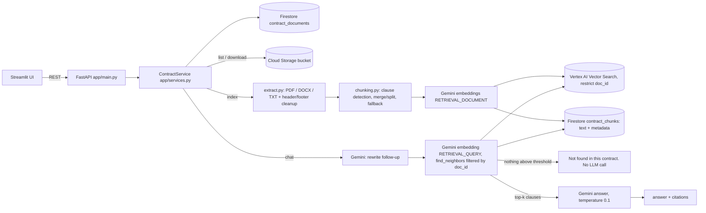

# Contract Document Chat (document-scoped RAG on Google Cloud)

Pick a contract from a list. The app embeds it (only if it isn't indexed already),
and you chat with **only that contract**. Answers are grounded in the contract text
and cite clause numbers.

| Concern | Google Cloud (default) | Local alternative (dev/tests) |
|---|---|---|
| Embeddings | Gemini `gemini-embedding-001` (768-d, `RETRIEVAL_DOCUMENT` / `RETRIEVAL_QUERY`) | `hash` (offline, lexical) |
| LLM | Gemini `gemini-2.5-flash`, via Gemini API key **or** Vertex AI | – |
| Contract files | Cloud Storage bucket (`gs://BUCKET/contracts/`) | `./contracts` folder |
| Document registry | Firestore collection `contract_documents` | SQLite |
| Vectors | Vertex AI Vector Search (streaming index, `doc_id` restrict) | ChromaDB |
| Chunk text + metadata | Firestore collection `contract_chunks` | (inside ChromaDB) |

Backend: FastAPI (`app/`). Frontend: Streamlit (`ui/streamlit_app.py`). Extraction uses
pdfplumber (PDF), python-docx (DOCX) and a plain read (TXT).

## Google Cloud setup

1. Enable the APIs:
   ```bash
   gcloud services enable aiplatform.googleapis.com firestore.googleapis.com storage.googleapis.com --project YOUR_PROJECT
   ```
2. Create a Firestore database in Native mode (skip if you already have one):
   ```bash
   gcloud firestore databases create --location=us-central1 --project YOUR_PROJECT
   ```
3. Authenticate for Cloud Storage, Firestore and Vector Search using Application Default Credentials:
   ```bash
   gcloud auth application-default login
   ```
   Or set `GOOGLE_APPLICATION_CREDENTIALS` to a service-account key. The account needs
   *Storage Object Admin*, *Cloud Datastore User* and *Vertex AI User* (plus
   *Vertex AI Administrator* to run the setup script).
4. Create the bucket and the Vector Search index and endpoint, then deploy the index. Deployment takes about 20–40 minutes:
   ```bash
   python scripts/setup_gcp.py --project YOUR_PROJECT --region us-central1 --bucket YOUR_BUCKET --upload-samples
   ```
   The script prints the `VERTEX_*` values for `.env`. A deployed index is billed per node-hour
   even when idle, so undeploy it when you're not using it.
5. Configure Gemini in `.env`, choosing one option:
   - **Gemini API key** (AI Studio): `GOOGLE_API_KEY=...`, `GOOGLE_GENAI_USE_VERTEXAI=false`
   - **Vertex AI** (ADC): `GOOGLE_GENAI_USE_VERTEXAI=true` with `GCP_PROJECT` and `GCP_LOCATION`
   - **Vertex AI express mode**: `GOOGLE_GENAI_USE_VERTEXAI=true`, `GOOGLE_API_KEY=<vertex key>`, `GCP_PROJECT` unset

## Install and run

```bash
python -m venv .venv && source .venv/bin/activate   # Python 3.11+
pip install -r requirements.txt
cp .env.example .env        # fill in project, bucket, key and VERTEX_* values
uvicorn app.main:app --reload          # backend on http://localhost:8000 (docs at /docs)
streamlit run ui/streamlit_app.py      # frontend on http://localhost:8501
```

To add contracts, upload them to the bucket and press **Refresh list**:

```bash
gsutil cp my_contract.pdf gs://YOUR_BUCKET/contracts/
```

**Local mode** (no GCP for storage/vectors; Gemini still needs a key for chat):
`CONTRACTS_SOURCE=local REGISTRY_BACKEND=sqlite VECTOR_STORE=chroma`.
Add `EMBEDDING_PROVIDER=hash` to index with no API at all.

The tests need no network, key or project:

```bash
pytest -q
```

### Configuration

All settings are listed in `.env.example`. The key ones:

| Variable | Default | Meaning |
|---|---|---|
| `EMBEDDING_MODEL` / `EMBEDDING_DIM` | `gemini-embedding-001` / `768` | dimension must match the index |
| `LLM_MODEL` | `gemini-2.5-flash` | answering + follow-up rewrite model |
| `TOP_K` | `5` | clauses retrieved per question |
| `SIMILARITY_THRESHOLD` | `0.5` | cosine cut-off (`0` disables). Tune it on your data: the backend logs every score. |
| `MAX_CHUNK_TOKENS` / `MIN_CHUNK_TOKENS` | `800` / `50` | split / merge thresholds |

If you change the embedding model or dimension, create a new index with the matching
dimension and re-index the documents (the **Re-index** button, or `?force=true`).

## API

| Method | Path | Description |
|---|---|---|
| `GET` | `/documents` | Files in `./contracts` with `doc_id`, `file_name`, `size`, `status` |
| `GET` | `/documents/{doc_id}` | One document (used for polling) |
| `POST` | `/documents/{doc_id}/index` | Index unless already `ready`. Runs in the background (`202`, status `processing`). `?wait=true` runs it synchronously, `?force=true` re-indexes. |
| `POST` | `/chat` | `{doc_id, question, history:[{role, content}]}` → `{answer, citations:[{clause_no, clause_title, snippet, page}], standalone_question}` |

`doc_id` is the SHA-256 of the file content. When a file is edited it gets a new
`doc_id` and shows up as `not_indexed`. Vectors and registry rows for content
that no longer exists are pruned on the next listing.

## Architecture



Vector Search stores only vectors. Each datapoint (`{doc_id}_{chunk_index}`) carries a
`doc_id` restrict, and every query passes `Namespace("doc_id", [doc_id])`, so neighbours can only
come from the selected contract. The text and metadata of the returned ids are read from
Firestore, and any result whose `doc_id` doesn't match is dropped as a second check.

**Ingestion** (`POST /documents/{id}/index`): status `processing`, then extract and clean,
then clause chunking, then embed in batches, then delete old chunks for the `doc_id` and upsert,
then status `ready`. Any error (unsupported file, empty text, Gemini/GCP API failure) sets the status to `failed`
with the message stored in the registry and logged. Documents left in `processing` by a crash are
reset at startup.

**Chat** (`POST /chat`): if there is history, the LLM rewrites the follow-up into a standalone
question. The question is embedded with the same model and Chroma is queried with
`where={"doc_id": doc_id}` (top 5). Results under the similarity threshold are dropped.
If nothing is left, the answer is `"Not found in this contract."` and the LLM is not called.
Otherwise the system prompt, retrieved clauses, history and question go to the LLM.
Citations are the retrieved clauses the answer actually names, or all retrieved clauses if it names none.

## Chunking strategy

Contracts are organised by clauses, and users ask about clauses, so each chunk is one clause.

1. **Cleaning.** Page numbers (`12`, `- 12 -`, `Page 3 of 9`) are removed. Short lines that repeat
   at the top or bottom of at least half the pages (digits normalised) are treated as running
   headers or footers and removed. TXT files use form-feeds (`\f`) as page breaks.
2. **Heading candidates.** Regexes match `1.`, `1.1`, `2.3.1`, `1.1.`, `Clause 5`, `Article IV`
   and `Section 3`, optionally followed by a title (`7.2 Notice Period. Either party ...` gives
   the title *Notice Period*). A bare `5` with no dot (as in `5 days`) is never a heading. A
   heading followed by a lowercase word (`Section 3 of this Agreement`) is treated as a cross-reference.
3. **Validation.** Headings must form a plausibly increasing sequence: first child (`7` to `7.1`),
   sibling or next parent (`7.2` to `7.3` to `8`), or a new parent without its own line (`3.2` to `4.1`),
   allowing small gaps. A dynamic-programming pass keeps the best such chain, preferring titled
   headings. This drops numbered list items inside a clause and stray numbers. Families are
   resolved top-down (Article, then Section, then numeric), and numbering may restart inside each Article.
4. **Clauses.** Text between two headings is one clause. Text before the first heading is the
   `Preamble` (parties, recitals).
5. **Merge tiny clauses.** A clause under 50 tokens (typically a bare parent heading like
   `9. TERMINATION`) is merged into the next clause under the same parent. The result is
   `clause_no = "9, 9.1"`.
6. **Split long clauses.** A clause over 800 tokens is split on sub-clause markers (`(a)`, `(iv)`,
   `7.2.1`) and paragraphs, then packed greedily. A single oversized paragraph is split by
   sentences. Every piece starts with `[Clause X – Title] (part k of n)`.
7. **Header.** Every chunk's text starts with `[Clause 7.2 – Notice Period]`, so the embedding and
   the LLM both see where the text comes from.
8. **Fallback.** If fewer than 3 clause headings are found, a LangChain-style recursive character
   splitter is used (1000 chars, 150 overlap, separators `\n\n`, `\n`, `. `, ` `). Those chunks are
   labelled `Part N`.

Chunk metadata: `doc_id, file_name, clause_no, clause_title, chunk_index, page` (page only when known, i.e. PDFs and paginated TXT).

## Project structure

```
app/
  main.py         FastAPI routes + wiring of the backends
  config.py       settings from .env
  db.py           document registry: Firestore (default) / SQLite
  sources.py      contract files: Cloud Storage (default) / local folder
  extract.py      text extraction + cleaning
  chunking.py     clause detection, split/merge, fallback splitter
  vectorstore.py  Vertex AI Vector Search + Firestore chunk store (default) / ChromaDB
  llm.py          Gemini client (API key or Vertex AI), embeddings, rewrite, answer
  prompts.py      system and rewrite prompts
  services.py     ingestion + chat orchestration
scripts/setup_gcp.py  creates bucket, Vector Search index + endpoint, deploys the index
ui/streamlit_app.py
tests/
  test_chunking.py  clause regex, validation, long-clause split, tiny merge, fallback, cleaning
  test_chat.py      doc_id isolation (Chroma and a fake Vertex index), "not found", statuses, API
  test_gcp.py       Gemini adapters (task types, batching, role mapping), client auth modes
contracts/          two sample .txt contracts (upload with --upload-samples)
```

## Notes

- Chunk sizes are measured with `tiktoken` (`cl100k_base`) as an approximation of Gemini
  tokens. If the encoding can't be downloaded, the app falls back to an estimate of chars/4.
- The Gemini, Cloud Storage, Firestore and Vector Search adapters have unit tests with fakes,
  but have not been run against a live project yet.
- Assumes text-only contracts. Scanned PDFs (no text layer) end up as `failed` with "No extractable text".
