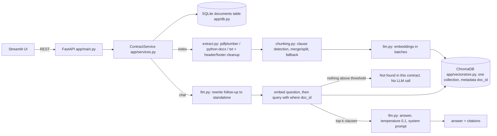

# Contract Document Chat (document-scoped RAG)

Pick a contract from a list, the app embeds it into ChromaDB (only if it isn't
indexed already), and you chat with **only that contract**. Answers are grounded
in the contract text and cite clause numbers.

- **Backend:** FastAPI (`app/`)
- **Frontend:** Streamlit (`ui/streamlit_app.py`)
- **Extraction:** pdfplumber (PDF), python-docx (DOCX), plain read (TXT)
- **Vector DB:** ChromaDB, persistent in `./chroma_db`, one collection filtered by `doc_id`
- **Embeddings / LLM:** OpenAI `text-embedding-3-small` / `gpt-4o-mini` by default (configurable)

## Setup

```bash
python -m venv .venv && source .venv/bin/activate   # Python 3.11+
pip install -r requirements.txt
cp .env.example .env        # then set OPENAI_API_KEY
```

Put your `.pdf`, `.docx` or `.txt` contracts in `./contracts` (two samples are included).

## Run

```bash
uvicorn app.main:app --reload          # backend on http://localhost:8000 (docs at /docs)
streamlit run ui/streamlit_app.py      # frontend on http://localhost:8501
```

Run the tests (they need no API key or network):

```bash
pytest -q
```

### Configuration (`.env`)

| Variable | Default | Meaning |
|---|---|---|
| `EMBEDDING_PROVIDER` | `openai` | `openai`, or `hash` (offline lexical embedder for demos/tests) |
| `EMBEDDING_MODEL` | `text-embedding-3-small` | embedding model |
| `LLM_PROVIDER` / `LLM_MODEL` | `openai` / `gpt-4o-mini` | answering + rewrite model |
| `OPENAI_BASE_URL` | – | any OpenAI-compatible endpoint (Azure proxy, vLLM, Ollama, ...) |
| `MAX_CHUNK_TOKENS` / `MIN_CHUNK_TOKENS` | `800` / `50` | split / merge thresholds |
| `FALLBACK_CHUNK_SIZE` / `FALLBACK_CHUNK_OVERLAP` | `1000` / `150` | fallback splitter (chars) |
| `TOP_K` | `5` | chunks retrieved per question |
| `SIMILARITY_THRESHOLD` | `0.2` | cosine similarity cut-off (`0` keeps everything) |
| `CONTRACTS_DIR`, `CHROMA_DIR`, `SQLITE_PATH` | `./contracts`, `./chroma_db`, `./data/documents.db` | paths |

If you change the embedding model, re-index your documents (the **Re-index** button,
or `POST /documents/{doc_id}/index?force=true`). Query and chunk vectors must come from the same model.

## API

| Method | Path | Description |
|---|---|---|
| `GET` | `/documents` | Files in `./contracts` with `doc_id`, `file_name`, `size`, `status` |
| `GET` | `/documents/{doc_id}` | One document (used for polling) |
| `POST` | `/documents/{doc_id}/index` | Index unless already `ready`. Runs in the background (`202`, status `processing`). `?wait=true` runs it synchronously, `?force=true` re-indexes. |
| `POST` | `/chat` | `{doc_id, question, history:[{role, content}]}` → `{answer, citations:[{clause_no, clause_title, snippet, page}], standalone_question}` |

`doc_id` is the SHA-256 of the file content. When a file is edited it gets a new
`doc_id` and shows up as `not_indexed`. Vectors and registry rows for content
that no longer exists are pruned on the next listing.

## Architecture



**Ingestion** (`POST /documents/{id}/index`): status `processing`, then extract and clean,
then clause chunking, then embed in batches, then delete old chunks for the `doc_id` and upsert,
then status `ready`. Any error (unsupported file, empty text, API failure) sets the status to `failed`
with the message stored in the registry and logged. Documents left in `processing` by a crash are
reset at startup.

**Chat** (`POST /chat`): if there is history, the LLM rewrites the follow-up into a standalone
question. The question is embedded with the same model and Chroma is queried with
`where={"doc_id": doc_id}` (top 5). Results under the similarity threshold are dropped.
If nothing is left, the answer is `"Not found in this contract."` and the LLM is not called.
Otherwise the system prompt, retrieved clauses, history and question go to the LLM.
Citations are the retrieved clauses the answer actually names, or all retrieved clauses if it names none.

## Chunking strategy

Contracts are organised by clauses, and users ask about clauses, so each chunk is one clause.

1. **Cleaning.** Page numbers (`12`, `- 12 -`, `Page 3 of 9`) are removed. Short lines that repeat
   at the top or bottom of at least half the pages (digits normalised) are treated as running
   headers or footers and removed. TXT files use form-feeds (`\f`) as page breaks.
2. **Heading candidates.** Regexes match `1.`, `1.1`, `2.3.1`, `1.1.`, `Clause 5`, `Article IV`
   and `Section 3`, optionally followed by a title (`7.2 Notice Period. Either party ...` gives
   the title *Notice Period*). A bare `5` with no dot (as in `5 days`) is never a heading. A
   heading followed by a lowercase word (`Section 3 of this Agreement`) is treated as a cross-reference.
3. **Validation.** Headings must form a plausibly increasing sequence: first child (`7` to `7.1`),
   sibling or next parent (`7.2` to `7.3` to `8`), or a new parent without its own line (`3.2` to `4.1`),
   allowing small gaps. A dynamic-programming pass keeps the best such chain, preferring titled
   headings. This drops numbered list items inside a clause and stray numbers. Families are
   resolved top-down (Article, then Section, then numeric), and numbering may restart inside each Article.
4. **Clauses.** Text between two headings is one clause. Text before the first heading is the
   `Preamble` (parties, recitals).
5. **Merge tiny clauses.** A clause under 50 tokens (typically a bare parent heading like
   `9. TERMINATION`) is merged into the next clause under the same parent. The result is
   `clause_no = "9, 9.1"`.
6. **Split long clauses.** A clause over 800 tokens is split on sub-clause markers (`(a)`, `(iv)`,
   `7.2.1`) and paragraphs, then packed greedily. A single oversized paragraph is split by
   sentences. Every piece starts with `[Clause X – Title] (part k of n)`.
7. **Header.** Every chunk's text starts with `[Clause 7.2 – Notice Period]`, so the embedding and
   the LLM both see where the text comes from.
8. **Fallback.** If fewer than 3 clause headings are found, a LangChain-style recursive character
   splitter is used (1000 chars, 150 overlap, separators `\n\n`, `\n`, `. `, ` `). Those chunks are
   labelled `Part N`.

Chunk metadata: `doc_id, file_name, clause_no, clause_title, chunk_index, page` (page only when known, i.e. PDFs and paginated TXT).

## Project structure

```
app/
  main.py         FastAPI routes
  config.py       settings from .env
  db.py           SQLite document registry
  extract.py      text extraction + cleaning
  chunking.py     clause detection, split/merge, fallback splitter
  vectorstore.py  ChromaDB wrapper (add, delete, query with doc_id filter)
  llm.py          embeddings, query rewriting, answer generation
  prompts.py      system and rewrite prompts
  services.py     ingestion + chat orchestration (kept out of the routes for testability)
ui/streamlit_app.py
tests/
  test_chunking.py  clause regex, validation, long-clause split, tiny merge, fallback, cleaning
  test_chat.py      doc_id isolation, "not found" (no LLM call), statuses, API
contracts/          two sample .txt contracts
```

## Notes

- Token counts use `tiktoken` (`cl100k_base`). If the encoding can't be downloaded
  (offline), the app falls back to an estimate of chars/4.
- Assumes text-only contracts. Scanned PDFs (no text layer) end up as `failed` with "No extractable text".
